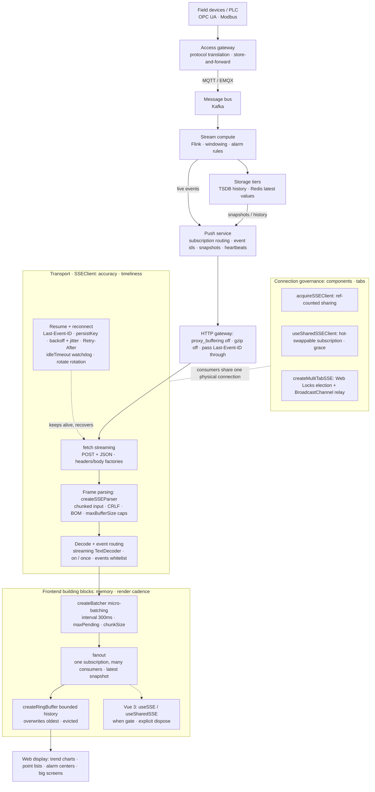

# @songfreedom/sse-client

English · [简体中文](./README.zh-CN.md)

[](https://www.npmjs.com/package/@songfreedom/sse-client)
[](./LICENSE)
[](https://bundlephobia.com/package/@songfreedom/sse-client)

A small, dependency-free Server-Sent Events client for the browser.
`fetch` transport, typed event routing, automatic reconnection with `Last-Event-ID` resume,
an idle watchdog and shared connections.

```ts
import { SSEClient } from "@songfreedom/sse-client";

const client = new SSEClient({
  url: "/api/push/subscribe",
  request: {
    body: { topics: ["alarm"] },
    headers: () => ({ authorization: `Bearer ${getToken()}` }),
  },
  parse: (raw) => JSON.parse(raw),
});

client.on("ALARM", (alarm) => console.log(alarm.level));
```

## Why not `EventSource`?

| Option | Problem |
| --- | --- |
| Native `EventSource` | Cannot set request headers (no way to send an auth token), GET only, no request body, no control over reconnection |
| [`@microsoft/fetch-event-source`](https://github.com/Azure/fetch-event-source) | Archived. Non-2xx responses must be rejected by hand in `onopen`, otherwise it silently reconnects forever; fixed retry interval; no `Last-Event-ID` persistence |

The core client is about 6 kB minified+gzipped, and about 9 kB for everything the `.`
entry exports (sharing, fan-out, ring buffer, batcher). No runtime dependencies, and only
`fetch` plus `ReadableStream` are required.

## Core pipeline: from data source to screen

A typical industrial chain (the library covers only the last hop):

```text
Field devices / PLC ─► access gateway ─► message bus ─► stream compute ─► storage tiers ─► push service ─► Web
 OPC UA/Modbus        MQTT/EMQX          Kafka          Flink           TSDB+Redis       SSE/WS         Vue/React
```

On the device side, OPC UA / Modbus is translated at the access gateway into MQTT (EMQX holds connections and QoS; the gateway buffers while the uplink is down) and bridged into Kafka through a rule engine or connector. Flink runs windowing and alarm rules; live events go straight to the push service while TSDB serves snapshots and history only. On the browser side the push service emits SSE — one-way, gateway-friendly, with `Last-Event-ID` resume; WebSocket only when you need a command channel. The two gateways are different things: the access gateway translates protocols, the HTTP gateway just forwards bytes without buffering.

Module view (solid lines carry data, dashed lines carry control and governance):



The library covers the last hop: `SSEClient` transports, `createBatcher` / `fanout()` / `createRingBuffer` consume. Three requirements, three sets of mechanisms:

- **Accuracy**: `Last-Event-ID` resume + `onSuspectGap` / `onResume` to prove continuity; throwing `parse` calls and handlers are isolated; terminal 401/403/404 stop immediately.
- **Timeliness**: streaming push + `idleTimeout` zombie reaping + exponential backoff (±20% jitter, `Retry-After` honoured) + gapless `overlap` rotation.
- **Memory**: pull backpressure + `maxBufferSize` (1 MB by default) caps + fixed-capacity `createRingBuffer`; `yieldEvery` / `createBatcher` keep tasks short.

## Capability map: transport · frontend · connection governance

**Transport** — where accuracy, timeliness and memory are won or lost:

- fetch transport: POST + JSON body, arbitrary headers; `headers` / `body` as functions are re-evaluated per (re)connect
- Event routing: `on()` infers payload types from an event map, `on("*")` wildcard, `once()` single delivery
- Frame parsing: arbitrarily chunked input, multi-line `data`, split CRLFs, BOM, comment heartbeats; `maxBufferSize` dual caps, `overflowPolicy: "close" | "drop"`
- Resume: `Last-Event-ID` + `resume.persist` across reloads + `resume.from` seeding; `hooks.gap` / `hooks.resume` continuity signals
- Reconnect governance: exponential backoff with jitter, `Retry-After` (delta-seconds and HTTP-date), in-stream `retry:`, async custom `retry`; terminal 401/403/404 stop immediately
- Connection health: idle watchdog, scheduled rotation (`restart` / `overlap`), offline pause/resume, `pauseWhenHidden`, `endSignal` for clean shutdown

**Frontend** — where display cadence and memory are decided:

- `createBatcher` micro-batching: coalesce high-frequency updates per business key, keep only the latest per window (300 ms default; `maxPending` for memory, `chunkSize` against long tasks, `leading` for sparse panels)
- `client.fanout()` fan-out: one subscription to many consumers, latest value kept per event, late-mounted components render immediately
- `createRingBuffer` bounded history: O(1) push, overwrites oldest; answers "the last N values", not "the last T seconds"
- Vue 3 `useSSE` / `useSharedSSE`: reactive `status` / `lastEvent`, a `when` readiness gate, explicit `dispose()` (no leaks even with two Vue copies in micro-frontends)
- Building blocks: `createSSEParser` / `createSSEMessageStream` (a standard `TransformStream`) for custom transports

**Connection governance** — many components and tabs without stepping on each other:

- `acquireSSEClient` shares one connection per key (ref-counted) — no wasted fan-out under the HTTP/1.1 six-connections-per-origin limit
- `useSharedSSEClient` hot-swaps subscriptions: listeners move on a key change; the old connection closes when its last consumer leaves
- `createMultiTabSSE` (from `@songfreedom/sse-client/multi-tab`) one connection per browser: Web Locks leader election + BroadcastChannel relay, followers take over from `lastId` when the leader closes (a `promote` gap is reported), degrades to `solo` without the platform APIs
- `createMockSSEFetch` from `@songfreedom/sse-client/testing`: deterministic in-process reproduction of reconnect / resume / hung gateways / rotation

## Consumer examples

How a business layer consumes the client lives in code: [`demo/consumers/`](./demo/consumers/README.md).
Each page has an editable panel, so scenario, interval and the other knobs can be switched
in the browser instead of the source.

| Folder | Scenario | Building blocks |
| --- | --- | --- |
| `alarm-center/` | Alarm center: resume, 401 self-healing, dedupe by id | `SSEClient` · header factory · `retry` · `resume.persist` |
| `point-board/` | Point dashboard: high-frequency points, one repaint per frame, bounded memory | `createBatcher` · `fanout()` · `createRingBuffer` · `yieldEvery` |
| `multi-tab/` | One connection across tabs | `createMultiTabSSE` |
| `vue-shared/` | Vue components sharing a connection, tenant switches | `useSharedSSE` · `subscription` getter |

```bash
pnpm build && pnpm demo:server
# open http://127.0.0.1:8787/demo/consumers/<folder>/index.html
```

## Choosing a client

The package exposes four subpaths — `.`, `./vue`, `./multi-tab`, `./testing` — but the
choice inside them comes down to which of three things you are duplicating: the
**consumer**, the **subscription**, or the **tab**.

| What is duplicated | Use | What it costs you |
| --- | --- | --- |
| Nothing — one consumer, one fixed subscription | `new SSEClient(options)` | You own the lifecycle: `close()` on unmount |
| Many components, **same** subscription | `acquireSSEClient(key, create)` | Ref-counted, so every consumer must `release()`; the subscription cannot change |
| Many components, subscription **moves** (floor, tenant, filter) | `useSharedSSEClient({ grace })` | Listener bookkeeping is yours; a key switch closes the old connection immediately |
| A Vue component | `useSSE(options)` / `useSharedSSE(options)` | Thin by design: refs, `on()`, `dispose()`. No history, no `configure` in `shared` mode |
| The same stream in **many tabs** | `createMultiTabSSE(options)` from `./multi-tab` | Needs Web Locks **and** `BroadcastChannel`; payloads must be structured-cloneable |
| Many consumers inside one tab, plus "what is the value right now?" | `client.fanout()` | Latest value only — it is not a store, and it keeps no history |
| History, or a controlled repaint cadence | `createRingBuffer` + `createBatcher` | You pick the capacity and the interval; the library keeps no default |
| Nothing — you only want to observe | `client.use(plugin)` | Attached once, torn down only on `close()`; not a hot-pluggable hook |

The boundaries that are easy to get wrong:

- **Sharing merges `parse`.** The key covers `url` / `method` / `body` / `events`,
  and the *first* caller's `parse` wins — the second consumer silently receives whatever it
  returns. Two consumers that decode differently need two keys.
- **A key switch is not grace-protected.** `grace` only delays the release on `close()`
  (route changes, remounts). `F1 → F2 → F1` is two reconnects; debounce the switch instead
  of letting a slider emit one key per pixel.
- **`fanout()` is not a store.** It keeps the *latest* payload per event name and nothing
  else — no history, no window, no replay. It also keeps the underlying `"*"` subscription
  after the last consumer unsubscribes, so `latest()` stays readable; only `dispose()`
  releases it.
- **A ring buffer is a count bound, not a time window.** It answers "the last N values",
  never "the values of the last T seconds".
- **A batcher changes cadence, not order.** With `leading: true` the first value of an idle
  window is delivered immediately and is *not* part of the trailing flush; with
  `chunkSize` set, `onFlush` is called once per slice, not once per window.
- **`multi-tab` degrades, it does not fall back.** Without both platform APIs every tab
  reports `solo` and opens its own connection. That is deliberate: a hand-rolled fallback
  can split-brain.
- **A plugin is attach-time, not lifecycle.** It runs when you call `use()`, and its
  teardown runs on `close()` only — it cannot follow `start()` / `stop()` cycles.

## Installation

```bash
pnpm add @songfreedom/sse-client
# or
npm install @songfreedom/sse-client
```

The Vue entry needs `vue` as a peer dependency (it is optional, so non-Vue users do not install it):

```bash
pnpm add @songfreedom/sse-client vue
```

Requires a browser with `fetch` and `ReadableStream` (all evergreen browsers), or Node 18+ for SSR and tests.

## Quick start

### Framework-agnostic

```ts
import { SSEClient } from "@songfreedom/sse-client";

interface Events {
  ALARM: { level: "high" | "low"; deviceId: string };
  POINT: { objectId: string; value: string };
}

const client = new SSEClient<Events>({
  url: "/api/sse/subscribe",
  request: {
    body: { topics: ["alarm"] },
    headers: () => authHeaders(),  // re-evaluated before every attempt
  },
  parse: (raw) => JSON.parse(raw),
  stream: { idleTimeout: 45_000 }, // heartbeat every 15s
});

const off = client.on("ALARM", (alarm) => {
  // `alarm` is typed as Events["ALARM"]
  console.log(alarm.deviceId);
});

// Later
off();
client.close();
```

### Vue 3

```vue
<script setup lang="ts">
import { computed, onUnmounted } from "vue";
import { useSSE } from "@songfreedom/sse-client/vue";

interface Events {
  ALARM: { level: "high" | "low"; deviceId: string };
}

const { status, lastEvent, on, dispose } = useSSE<Events>({
  url: "/api/push/alarm",
  request: { body: { topics: ["alarm"] } },
  parse: (raw) => JSON.parse(raw),
});

on("ALARM", (alarm) => console.log(alarm.level));

onUnmounted(dispose);

const connected = computed(() => status.value === "open");
</script>
```

`useSSE` returns refs for `status` / `lastEvent` / `error`, an `on()` for routing, and a
`dispose()` that unsubscribes what it registered and closes the connection. It keeps no
history — compose that with `createRingBuffer`
(see [`demo/consumers/point-board/`](./demo/consumers/point-board/main.js)).

Cleanup is explicit, not scope-based: `getCurrentScope()` returns `undefined` when the app
and the library resolve *different copies* of Vue (qiankun sub-apps), which leaks the
connection silently. `dispose()` is idempotent; `stop()` closes but keeps it usable.

`shared: true` (or `{ grace, keyOf }`) puts every component describing the same
subscription on one connection, with reference-counted releases.

Add `when` when the subscription target is not known yet. While it returns false no
request is issued, so a detail page no longer opens a throwaway subscription for
"no instance" and immediately replaces it:

```ts
const instanceId = ref<string>();
const { status } = useSSE({
  url: "/api/push",
  when: () => !!instanceId.value,
  request: { body: () => [{ instanceId: instanceId.value }] },
});
```

Both `when` and a `body` factory are re-read reactively: `useSharedSSE`'s
`subscription` getter, `useSSE`'s `when`, and any refs they touch. `when` wins over
`immediate` — a gate that is still shut issues no request at all — and while it stays
shut the reported status is `idle`, not `closed`: the stream has not ended, it has not
started.

## API

### `new SSEClient(options)`

Only `url` is required. Everything else is grouped by what it affects, and the
defaults are the operating point the client was designed around.

| Group | Field | Type | Default | What it does |
| --- | --- | --- | --- | --- |
| — | `url` | `string` | — | Request URL, including your gateway prefix |
| `request` | `method` | `"GET" \| "POST"` | `"POST"` | HTTP method |
| `request` | `body` | `unknown \| (() => unknown)` | — | Serialized as JSON; strings, `Blob` and `FormData` are sent as-is. A function is re-evaluated before every (re)connect, so filters can follow reactive state. Keep it pure: `deriveShareKey` resolves it too |
| `request` | `headers` | `HeadersInit \| () => HeadersInit \| Promise<HeadersInit>` | — | Pass a function to recompute headers on every (re)connect |
| `request` | `credentials` | `RequestCredentials` | `"same-origin"` | Use `"include"` when the SSE endpoint is on another origin and auth rides on cookies |
| `request` | `fetch` | `FetchLike` | global `fetch` | Custom transport |
| — | `parse` | `(raw: string) => unknown` | identity | Payload decoder; `jsonParse` from the package keeps the raw text when a frame is not JSON |
| `resume` | `from` | `string` | — | Resume point for the first request, sent as `Last-Event-ID`; use it to continue where a previous page load stopped |
| `resume` | `persist` | `string \| boolean` | — | Keep `lastEventId` in storage across reloads. `true` derives the key from the subscription; writes are throttled to 1/s and flushed on close and `pagehide` |
| `resume` | `storage` | `ResumeStorage \| null` | `sessionStorage` | Where `persist` reads and writes; `null` disables it (SSR, sandboxed iframes) |
| `resume` | `dedupe` | `boolean` | `false` | Suppress events whose id was already delivered, across reconnects. Turn it on for **token streams** (an AI reply), where an inclusive replay duplicates a visible token; leave it off for latest-value streams, where a duplicate is harmless and deduping retains one id per event |
| `retry` | *(function)* | `(ctx) => number \| false \| Promise<number \| false>` | — | Custom policy: it owns the delay, so the knobs below are ignored |
| `retry` | `max` | `number` | `Infinity` | Retry limit |
| `retry` | `baseDelay` | `number` | `1000` | Delay before the first retry (ms) |
| `retry` | `maxDelay` | `number` | `30000` | Upper bound for backoff (ms) |
| `retry` | `stableAfter` | `number` | `10000` | An attempt that lived this long resets the retry counter |
| `stream` | `idleTimeout` | `number` | `0` | Reconnect when no bytes arrive for this long. Set it to ~3× the heartbeat interval |
| `stream` | `rotate` | `number \| { interval, mode?, timeout? }` | `0` | Reconnect on a schedule. A number is shorthand for `{ interval }`; `mode` is `"restart"` (default) or `"overlap"` (pre-opened replacement, no gap); `timeout` defaults to `30000` |
| `stream` | `pauseWhenHidden` | `boolean` | `false` | Suspend while the page is hidden, reconnect when visible |
| `stream` | `endSignal` | `string` | — | Treat this `data` value as end-of-stream, e.g. `"[DONE]"` |
| `stream` | `events` | `string[]` | — | Allow-list of event names |
| `stream` | `reconnectOnEnd` | `boolean` | `true` | Reconnect when the server ends the stream normally |
| `stream` | `strictContentType` | `boolean` | `true` | Require `content-type: text/event-stream` |
| `limits` | `maxBufferSize` | `number` | `1MB` | Cap for a single message buffer (characters) |
| `limits` | `overflowPolicy` | `"close" \| "drop"` | `"close"` | On overflow: disconnect with a terminal `protocol` error, or drop that message and keep streaming — `dropped` counts it and `hooks.gap` reports `reason: "drop"` |
| `limits` | `yieldEvery` | `number` | `0` | Parse at most this many events per task, then yield; `0` keeps a whole chunk in one task |
| `hooks` | `open` `message` `status` `error` `close` `gap` `resume` `handlerError` | callbacks | `console.error` for `handlerError` | Observers; each is equivalent to the matching `onXxx()` method |
| — | `autoStart` | `boolean` | `true` | Connect in the constructor |

`hooks` is the declarative spelling of the lifecycle subscriptions: `hooks.status`
and `client.onStatus(...)` see the same events, so pick one per concern. Act on
`hooks.gap` (`{ reason, lastId, attempt }`); log `hooks.resume`
(`{ lastId, firstId, skipped, continuous }`).

A grouped field wins over the deprecated flat spelling (`body`, `idleTimeout`,
`onStatus`, …), which is still accepted for one minor version. Two former
options are gone rather than deprecated: `flags` (append the query string
yourself) and `onOverflow` (watch `dropped`, or `hooks.gap` with
`reason: "drop"`).
#### Properties

| Property | Type | Description |
| --- | --- | --- |
| `status` | `SSEStatus` | `idle` · `connecting` · `open` · `reconnecting` · `closed` |
| `closed` | `boolean` | Terminal state; the client will not reconnect |
| `attempts` | `number` | Consecutive retries; resets after a stable connection |
| `lastEventId` | `string` | Latest event id, sent back on reconnect |
| `url` | `string` | The URL requested |
| `dropped` | `number` | Messages discarded by the cap (only grows with `overflowPolicy: "drop"`) |
| `invalidIds` | `number` | Ids refused because they cannot survive a `Last-Event-ID` round trip (whitespace, newline, NUL, empty), including the ones `setResumePoint` was handed. The resume point is never advanced to one, and the message is still delivered |
| `duplicates` | `number` | Events suppressed as replays under `resume.dedupe` |
| `done` | `Promise<void>` | Resolves when the connection terminates; never rejects |

#### Methods

| Method | Description |
| --- | --- |
| `start()` | Open the connection (no-op while running or suspended) |
| `close()` | Close and stop reconnecting |
| `restart()` | Close, then reconnect while keeping `lastEventId` |
| `setResumePoint(id)` | Replace the resume point used by the **next** connection, e.g. with a snapshot id after a gap. An id that cannot be echoed back is refused (the old point is kept, `invalidIds` grows) |
| `on(event, handler)` | Subscribe to one event name; returns an unsubscribe function |
| `on("*", handler)` | Subscribe to every message |
| `once(event, handler)` | Subscribe for a single delivery |
| `onMessage` / `onStatus` / `onError` / `onOpen` / `onClose` / `onSuspectGap` / `onResume` | Lifecycle subscriptions (the imperative form of `hooks`) |
| `fanout()` | One `"*"` subscription, many consumers, plus a latest-value snapshot per event (memoised) |
| `use(plugin)` | Attach a plugin; a returned function runs once on close |

`start()` also queues itself when a `close()` has not finished unwinding yet, so
`stop(); start();` in the same tick reconnects instead of doing nothing.

### `useSharedSSEClient(config?)`

`acquireSSEClient` covers "one subscription, many consumers". This covers the harder half:
the subscription itself changes while the consumer stays mounted. The handle owns your
subscription description and your listeners; the connection belongs to a key.

```ts
const sse = useSharedSSEClient({ grace: 5_000 });

sse.on("POINT", apply);                            // buffered: nothing connects yet
sse.configure({ url, request: { body: { tenantId: "acme" } } }); // open or reuse the matching one
watch(tenantId, (id) => sse.configure({ url, request: { body: { tenantId: id } } }));
onScopeDispose(() => sse.release());
```

`configure` derives the key, returns early when it is unchanged, moves your listeners to the
matching client (reusing it when a peer already holds it), then decrements the previous key's
reference count — which is why a switch does not disturb a peer still on the old key.

| Call | Effect |
| --- | --- |
| `configure(sameKey)` | Nothing; returns the key. Safe from a watcher that fires often. |
| `configure(newKey)` | Listeners move to the new connection; the old one loses a reference and is closed immediately (**no grace**). |
| `configure()` / `configure({})` | Stop consuming, keep the handle usable. |
| `close()` | Detach listeners, drop a reference, keep the handle. A later `configure` re-attaches them. |
| `release()` | Final: idempotent, further `configure` calls return `null`. |

Properties: `key`, `client`, `status`, `configured`. `client` is a **getter** — it can be a
different instance after a switch, so do not cache it. `status` is `idle` before the first
`configure`.

Continuity signals belong to the handle for the same reason: `onSuspectGap` and `onResume`
are re-attached on every switch, while a listener bound to a cached `client` goes silent
the moment the subscription moves.

Two things specific to this handle:

- **`grace` only applies to `close()`.** It exists for remounts (route changes), not for
  subscription changes.
- **`useSSE({ shared: true })` is the fixed-subscription flavour** and does not expose
  `configure`. Use the handle directly when the subscription moves.

`config`: `grace` (ms an unreferenced connection stays open, default 0), `keyOf` (defaults
to `deriveShareKey`), `create` (client factory, defaults to `new SSEClient`).

The decision table in [Choosing a client](#choosing-a-client) covers when this handle is the
right tool: `acquireSSEClient` when the subscription never changes (`useSharedSSEClient`
needs listener bookkeeping you would not use), and `createMultiTabSSE` when the duplication
is across tabs rather than components.

### `deriveShareKey(options)`

Stable key from `url`, `method`, `body` and `events`; object keys are sorted and
arrays are compared as sets. A `body` factory is resolved first, so changed filters mean a
different key. Exposed so an explicit `key` can follow the same rules.

### `createJoinClient(options)`

Replay an existing run from the start, then hand its tail to the live connection. For F5, a new
tab, and a multi-tab takeover — the new reader has seen nothing, and `Last-Event-ID` cannot
express "from the beginning".

```ts
import { SSEClient, createJoinClient } from "@songfreedom/sse-client";

const live = new SSEClient({ url: "/api/chat", request: { body: { threadId } } });

// The page reopened: replay the run, then continue from where it ended.
const { done } = createJoinClient({
  url: "/api/chat",
  join: { runId },
  parse: JSON.parse,
});
live.setResumePoint(await done);
```

Three deliberate choices, all so one request asks one question:

- **No `Last-Event-ID`.** The cursor on this route is `offset`; adding a stale header lets the
  server pick whichever it prefers.
- **`reconnectOnEnd` off.** A replay is a finite read; reconnecting past its final offset only
  opens an empty window.
- **`method: "GET"`, no body**, so the server cannot mistake it for a new subscription.
- **No persistence.** A replay is a reader, not the owner of the subscription: writing the same
  storage key would race the live client, and an aborted replay would leave a half-consumed
  position behind. `done` is the only handover.

`done` resolves with the last id once the stream ends, and `""` when the server sent no ids at
all (only a snapshot can be trusted then). `join.params` renames the query parameters,
`join.startOffset` changes the "from the start" value, and `deriveJoinUrl(url, join)` builds the
URL alone (keeping existing parameters and the hash).

### `isValidEventId(id)`

Whether an id can echo back through `Last-Event-ID`: non-empty, no `\r`/`\n`/`\0`, no leading or
trailing whitespace. The client checks received ids and `setResumePoint` arguments with it;
it is exported so a server and its tests can share one rule instead of writing their own.

### `SSEMessage`

```ts
interface SSEMessage<T = unknown> {
  id: string;          // event id, inherited from the previous event when omitted
  event: string;       // "message" when the server sends no `event:` field
  data: T;             // `parse` output
  raw: string;         // raw payload text
  receivedAt: number;  // client receive timestamp
}
```

### `SSEResumeInfo`

The argument of `onResume`, reported only for connections whose request carried a
`Last-Event-ID`:

```ts
interface SSEResumeInfo {
  lastId: string;                   // the resume point that was sent
  firstId: string;                  // first event with an id on the new connection
  skipped: number | undefined;      // firstId - lastId; undefined for opaque ids
  continuous: boolean | undefined;  // true when skipped <= 1; undefined without numeric ids
  attempt: number;                  // which attempt the new connection belongs to
}
```

`skipped: undefined` does not mean "nothing was skipped" — it means the client refuses
to guess. SSE ids are opaque strings and the spec never promises they are ordered, so
the two fields are only conclusive when the server sends incrementing integers.

### Error kinds

`SSEError.kind` is meant for logging and for branching inside a retry policy:

| `kind` | Meaning | Retried by default |
| --- | --- | --- |
| `http` | Non-2xx response (`status` is set) | Yes for 408/425/429/5xx, otherwise no |
| `network` | DNS failure, connection reset, … | Yes |
| `heartbeat` | Idle timeout, the connection looks zombie | Yes |
| `protocol` | Wrong `content-type`, buffer overflow, unreadable body | No |
| `aborted` | Interrupted (hidden page, offline, manual close) | No |
| `retry-exhausted` | Retry budget spent | No |

An `http` error carries `retryAfter` (ms) when the response had a `Retry-After`
header, and the built-in backoff uses it — clamped between 200ms and `retryMaxDelay`
— instead of the exponential curve. A custom `retry` policy can read the same field.

## Continuity in one page

Four signals, four different jobs. Most misuse of this library comes from wiring one of
them to a question it cannot answer.

| Signal | Fires when | What you learn | What to do with it |
| --- | --- | --- | --- |
| `lastEventId` (property) | after any event that carried an `id:` | the point the **next** connection will ask for | nothing — it is the bookkeeping the rest builds on |
| `hooks.gap` (`onSuspectGap`) — `{ reason, lastId, attempt }` | once per episode, when continuity **cannot be proven**: `reconnect` (an attempt ended), `resume` (page or network came back), `rotate` (`restart` mode only), `drop` (a message exceeded `maxBufferSize`), `promote` (a tab took over), `id` (the server sent an id that cannot be echoed back) | only that something *may* be missing — never what | refetch a snapshot, then `setResumePoint(snapshot.id)` |
| `hooks.resume` (`onResume`) — `{ lastId, firstId, skipped, continuous }` | on the first event with an id, after a request that carried `Last-Event-ID` | whether the server continued, and how far it jumped; both `skipped` and `continuous` are `undefined` when ids are opaque | metrics and logs; `continuous === false` means a real hole |
| `setResumePoint(id)` | you call it | which point the next connection asks for | right after healing a gap, with the snapshot id |

Two rules keep them apart:

- **`hooks.gap` decides what to do; `hooks.resume` decides what to report.** Do not trigger
  the snapshot refetch from `continuous === false`: that report arrives on the first event
  of the recovered stream, so you would paint new data and then overwrite it.
- **Never rewrite the resume point of the live stream.** `setResumePoint` applies to the
  *next* connection by design; changing `Last-Event-ID` mid-stream desynchronises the
  parser instead of healing the gap.

If the server sends no `id:`, the resume story does not exist: there is nothing to ask the
server to continue from, so neither `hooks.gap` (except for `drop`, which is local data
loss) nor `hooks.resume` will fire. Treat a silently lossy stream as a server-contract problem,
not something the client can paper over.

### An id has to echo back

An id makes a round trip the client does not control: into the `Last-Event-ID` header, and
possibly into `sessionStorage`. Every hop eats something — `\r`, `\n` and `\0` cannot live in
a header value, and leading/trailing whitespace is trimmed. So the id is validated
(`isValidEventId`) **before it is accepted**: an unmatchable one is refused, the resume point
**stays where it was**, the message is still delivered (its payload is not in question, only
the position it claimed), `invalidIds` grows, and `hooks.gap` reports it once with
`reason: "id"`.

Refusing matters. Accepting a point the server cannot match is worse than having none: the next
connection asks for a position the server does not know, the stream restarts somewhere
arbitrary, and **nothing reports it** — because nothing looked wrong.

`setResumePoint` and the point picked up from storage go through the same check. A poisoned
`sessionStorage` value (rewritten by a proxy, hand-edited) is dropped instead of breaking every
reconnect for that tab.

## Low-level building blocks

The client is assembled from small pieces that are exported for advanced use:

```ts
import {
  createSSEParser,
  createSSEMessageStream,
  createBatcher,
  createRingBuffer,
} from "@songfreedom/sse-client";

// bytes → messages, as a standard TransformStream
const messages = response.body!.pipeThrough(createSSEMessageStream({ parse: JSON.parse }));

// raw frames, if you want to drive the loop yourself
const parser = createSSEParser({ onEvent: (event) => console.log(event) });
parser.feed("event: ping\ndata: 1\n\n");

// fixed-capacity history: O(1) push, one allocation, oldest value overwritten
const ring = createRingBuffer<SSEMessage>({ capacity: 500 });
ring.push(message);
ring.toArray(); // a fresh array, safe to hand to a reactive ref
ring.into(reused); // same order, into an existing array, no allocation
```

A ring buffer is a *storage* bound, not a sliding window: it answers "the last N values",
not "the values of the last T seconds". Aggregating across a known gap produces a
number that is wrong without being obviously wrong, so keep business windows on the
server and use the buffer for what the chart displays.

## Server requirements

### Transport

- Respond with `Content-Type: text/event-stream` (a `;charset=UTF-8` suffix is fine).
- Do not buffer the response: `proxy_buffering off; proxy_cache off;` at the gateway,
  and do not gzip the stream.
- Send a heartbeat comment (`: ping\n\n`) every 15–30s, otherwise most load balancers
  close the connection after 60s of silence. Pair it with `idleTimeout`.

### Ids and resume (what makes `Last-Event-ID` trustworthy)

`hooks.resume` only checks what the server *says* it resumed from; it cannot prove the
server actually can. Four rules make it true:

1. **An id must echo back**: non-empty, no `\r`/`\n`/`\0`, no leading or trailing
   whitespace. The client refuses one that does not (`isValidEventId`); the server should
   not mint one in the first place.
2. **One id per event, unique.** Two events sharing an id means a resume starts in the
   middle of one.
3. **Persist, then send.** An id means "everything up to here is stored". If the server
   writes the socket first and the log asynchronously, a client returning with that id may
   find the entry missing — it computes a `skipped` that looks continuous while the event is
   already gone. This is the one contract the client cannot discover on its own.
4. **If you replay inclusively, let the client dedupe.** Re-sending the last event is legal
   (`skipped === 0` reports it), but for a token stream it is a visible error: send strictly
   after the id, or turn on `resume.dedupe`.

### A disconnect is not a cancel

`pauseWhenHidden`, going offline and a page reload all **abort the request**. If the server
reads "socket closed" as "the user wants to stop", switching back to the tab shows half an
answer. Keep them apart: a dropped connection only means **no observer** — the run should
finish into the log; only an explicit cancel stops it. `setResumePoint` and `joinRun` both
depend on that distinction.

### A second, read-only channel (F5, new tab, multi-tab takeover)

`Last-Event-ID` can only say "continue after this"; it cannot say "replay this run from the
start", which is exactly what a freshly opened page needs. Provide both:

- `POST` for subscriptions, carrying `Last-Event-ID` for incremental resume;
- `GET ?offset=-1&runId=…` for a read-only replay that **starts no generation**, safe to call
  from a new tab.

The client counterpart is `createJoinClient()`, below.

### Snapshot semantics

The standard reaction to `hooks.gap` is "refetch a snapshot, then
`setResumePoint(snapshot.id)`". For that to be reliable, the snapshot endpoint must return
what is stored **at the moment of the call, never waiting for new data**, and return empty
rather than erroring or parking when there is nothing. Otherwise healing a gap introduces a
new timeout of its own.

## Design notes

- No business logic: authentication goes through `headers`; tokens, stores and routing stay
  out of the client.
- Errors never escape as exceptions from callbacks; a throwing handler is isolated and
  reported through `onHandlerError` while the stream keeps flowing.
- Timers are always cleared on close, and the connection loop only exits when the client is
  finally closed, so suspending and resuming cannot leak a loop.

## Development

```bash
pnpm install
pnpm test         # vitest
pnpm coverage     # vitest + the thresholds in vitest.config.ts
pnpm typecheck    # tsc --noEmit
pnpm lint         # eslint
pnpm build        # dist/ + dist/package.json
```

Integration demo (real browser + real Nginx, plus a headless smoke run):
see [demo/README.md](./demo/README.md) — `pnpm demo:server` / `pnpm demo:smoke` /
`pnpm demo:matrix` / `pnpm demo:consumers` / `pnpm demo:memory`.

CI lives in `.github/workflows/ci.yml`.

## License

[MIT](./LICENSE)
