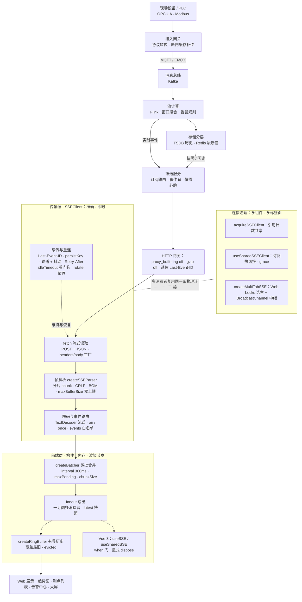

# @songfreedom/sse-client

[English](./README.md) · 简体中文

[](https://www.npmjs.com/package/@songfreedom/sse-client)
[](./LICENSE)
[](https://bundlephobia.com/package/@songfreedom/sse-client)

一个小巧、零依赖的浏览器 Server-Sent Events 客户端。
基于 `fetch` 传输，支持带类型的多路事件分发、带 `Last-Event-ID` 续传的自动重连、
空闲看门狗以及连接复用。

```ts
import { SSEClient } from "@songfreedom/sse-client";

const client = new SSEClient({
  url: "/api/push/subscribe",
  request: {
    body: { topics: ["alarm"] },
    headers: () => ({ authorization: `Bearer ${getToken()}` }),
  },
  parse: (raw) => JSON.parse(raw),
});

client.on("ALARM", (alarm) => console.log(alarm.level));
```

## 为什么不用 `EventSource`？

| 方案 | 问题 |
| --- | --- |
| 原生 `EventSource` | 无法设置请求头（没法带鉴权 token）、只支持 GET、不能带请求体、重连行为不可控 |
| [`@microsoft/fetch-event-source`](https://github.com/Azure/fetch-event-source) | 已归档。非 2xx 响应必须自己在 `onopen` 里拒绝，否则会静默无限重连；重试间隔固定；不保存 `Last-Event-ID` |

核心客户端压缩（min+gzip）后约 6 kB，`.` 入口全量导出约 9 kB（含共享连接、fanout、ring buffer、
batcher）。无运行时依赖，只要求环境提供 `fetch` 和 `ReadableStream`。

## 核心链路：从数据源到 Web 展示

一条典型的工业现场链路（本库只覆盖最后一段）：

```text
现场设备/PLC ─► 接入网关 ─► 消息总线 ─► 流计算 ─► 存储分层 ─► 推送服务 ─► Web
 OPC UA/Modbus  MQTT/EMQX     Kafka      Flink    TSDB+Redis   SSE/WS    Vue/React
```

设备侧 OPC UA / Modbus 在接入网关转成 MQTT（EMQX 承连接与 QoS，链路中断时网关缓存补传），再经规则引擎 / Connector 桥接到 Kafka；Flink 做窗口聚合与告警规则，实时事件直连推送服务，TSDB 只服务快照与历史。浏览器侧由推送服务转成 SSE——单向、能穿网关、带 `Last-Event-ID` 续传，需要双向命令才上 WebSocket。两个「网关」不是一回事：接入网关做协议转换，HTTP 网关只负责不缓冲地转发字节。

模块视图（实线为数据面，虚线为控制与治理）：



本库负责最后一段：`SSEClient` 管传输，`createBatcher` / `fanout()` / `createRingBuffer` 管消费。三个要求各对应一组机制：

- **准确**：`Last-Event-ID` 续传 + `onSuspectGap` / `onResume` 证明连续性；`parse` 与回调抛错被隔离，终态 401/403/404 立即停止。
- **即时**：流式推送 + `idleTimeout` 僵尸回收 + 指数退避（±20% 抖动、尊重 `Retry-After`）+ `overlap` 轮转零空档。
- **内存**：pull 背压 + `maxBufferSize`（默认 1MB）双上限 + `createRingBuffer` 定容；`yieldEvery` / `createBatcher` 防长任务。

## 能力地图：传输层 · 前端层 · 连接治理

**传输层**——准确 / 即时 / 内存的第一现场：

- fetch 传输：POST + JSON 请求体、任意请求头；`headers` / `body` 传函数则每次（重）连重新求值
- 事件路由：`on()` 从事件表推导载荷类型，`on("*")` 通配，`once()` 单次投递
- 帧解析：任意切分的 chunk、多行 `data`、CRLF 拆分、BOM、注释心跳；`maxBufferSize` 双重上限，`overflowPolicy: "close" | "drop"`
- 断线续传：`Last-Event-ID` + `resume.persist` 跨刷新 + `resume.from` 外部位点播种；`hooks.gap` / `hooks.resume` 连续性信号
- 重连治理：指数退避 + 抖动、`Retry-After`（delta-seconds 与 HTTP-date）、流内 `retry:` 字段、可异步自定义 `retry`；终态 401/403/404 立即停止
- 连接健康：空闲看门狗、定时轮转（`restart` / `overlap`）、离线挂起与恢复、`pauseWhenHidden`、`endSignal` 正常收尾

**前端层**——展示节奏与内存的现场：

- `createBatcher` 微批合并：按业务 key 合并高频更新，窗口内只留最新值（默认 300ms；`maxPending` 控内存，`chunkSize` 限长任务，`leading` 照顾稀疏面板）
- `client.fanout()` 扇出：一条订阅派发给多个消费者，每事件保留最新值，晚挂载组件立即渲染
- `createRingBuffer` 有界历史：O(1) 写入、覆盖最旧，回答「最近 N 条」而不是「最近 T 秒」
- Vue 3 `useSSE` / `useSharedSSE`：`status` / `lastEvent` 响应式、`when` 就绪门、显式 `dispose`（微前端双 Vue 副本也不泄漏）
- 底层构件：`createSSEParser` / `createSSEMessageStream`（标准 `TransformStream`）供自定义传输复用

**连接治理**——多组件、多标签页不互相踩：

- `acquireSSEClient` 按 key 共享连接（引用计数），HTTP/1.1 同源 6 连接限制下不浪费扇出
- `useSharedSSEClient` 订阅热切换：key 变了搬监听器，旧连接等最后一个使用方离开才关
- `createMultiTabSSE`（从 `@songfreedom/sse-client/multi-tab` 引入）多标签页一条连接：Web Locks 选主 + BroadcastChannel 中继，leader 关闭后 follower 从 `lastId` 接管（`promote` 报 gap），平台能力缺失降级 `solo`
- `@songfreedom/sse-client/testing` 的 `createMockSSEFetch`：进程内确定性复现重连 / 续传 / 挂死网关 / 轮转

## 消费侧示例

业务层怎么消费，直接看代码：[`demo/consumers/`](./demo/consumers/README.zh-CN.md)。
每个页面带可编辑面板，场景、间隔等参数直接在浏览器里切换，不用改源码。

| 目录 | 场景 | 关键构件 |
| --- | --- | --- |
| `alarm-center/` | 告警中心：续传、401 自愈、按 id 去重 | `SSEClient` · 函数式 `headers` · `retry` · `resume.persist` |
| `point-board/` | 测点看板：高频测点、按帧重绘、内存有界 | `createBatcher` · `fanout()` · `createRingBuffer` · `yieldEvery` |
| `multi-tab/` | 多标签页只开一条连接 | `createMultiTabSSE` |
| `vue-shared/` | Vue 多组件共享 + 订阅热切换 | `useSharedSSE` · `subscription` getter |

```bash
pnpm build && pnpm demo:server
# 打开 http://127.0.0.1:8787/demo/consumers/<目录>/index.html
```

## 选型：用哪个入口

包对外有四个子路径——`.`、`./vue`、`./multi-tab`、`./testing`——但选哪个，取决于**三种东西**
里哪一种正在被重复：消费者、订阅、标签页。

| 被重复的是什么 | 用哪个 | 代价 |
| --- | --- | --- |
| 没有重复：一个消费者、一个固定订阅 | `new SSEClient(options)` | 生命周期自己管，卸载时 `close()` |
| 多个组件、**同一个**订阅 | `acquireSSEClient(key, create)` | 引用计数，每个消费者都要 `release()`；订阅本身不能变 |
| 多个组件、订阅会**变**（租户、筛选、时间范围） | `useSharedSSEClient({ grace })` | 监听簿记由你做；切 key 会立刻关闭旧连接 |
| Vue 组件 | `useSSE(options)` / `useSharedSSE(options)` | 刻意做薄：ref + `on()` + `dispose()`；没有历史，`shared` 模式不暴露 `configure` |
| 同一个流出现在**多个标签页** | `createMultiTabSSE(options)`（`./multi-tab`） | 需要 Web Locks **和** `BroadcastChannel`；载荷必须可结构化克隆 |
| 同标签页多个消费者，还要「现在是多少」 | `client.fanout()` | 只留最新值——它不是 store，也不留历史 |
| 要历史，或要控制重绘节奏 | `createRingBuffer` + `createBatcher` | 容量与间隔由你定，库不提供默认 |
| 什么都不消费，只想观察 | `client.use(plugin)` | 挂载时跑一次，只在 `close()` 拆；不能热插拔 |

几条最容易踩错的边界：

- **共享会合并 `parse`。** key 只覆盖 `url` / `method` / `body` / `events`，而且
  **先创建者**的 `parse` 获胜——第二个使用方静默拿到它的返回值。解码方式不同就用两个 key。
- **切 key 不受 grace 保护。** `grace` 只延后 `close()` 的释放（路由切换、重新挂载）。
  `F1 → F2 → F1` 就是两次重连，该 debounce 的是切换，而不是让滑块每一像素产生一个 key。
- **`fanout()` 不是 store。** 它只按事件名保留**最新**载荷：没有历史、没有窗口、没有回放。
  最后一个消费者退订后，底层的 `"*"` 订阅仍然保留（这样 `latest()` 还读得到），只有
  `dispose()` 才释放它。
- **ring buffer 是数量界，不是时间窗。** 它回答「最后 N 条」，永远不回答「最近 T 秒」。
- **batcher 改的是节奏，不是顺序。** `leading: true` 时空闲窗口的第一个值立刻投递，且**不进**
  随后的尾批；设了 `chunkSize` 后，`onFlush` 会被调用多次（每片一次），不是每窗口一次。
- **`multi-tab` 是降级，不是回退方案。** 两个平台能力缺一个，每个标签页都报告 `solo` 并各自
  建连。这是有意的：手写的降级协议会脑裂。
- **插件是挂载期行为，不是生命周期。** 它在你调用 `use()` 时跑一次，teardown 只在 `close()`
  执行——跟不上 `start()` / `stop()` 的循环。

## 安装

```bash
pnpm add @songfreedom/sse-client
# 或者
npm install @songfreedom/sse-client
```

Vue 入口需要把 `vue` 作为 peer 依赖（它是可选的，不用 Vue 的项目不会安装）：

```bash
pnpm add @songfreedom/sse-client vue
```

要求环境支持 `fetch` 和 `ReadableStream`（所有常青浏览器），SSR 与测试场景需要 Node 18+。

## 快速开始

### 框架无关

```ts
import { SSEClient } from "@songfreedom/sse-client";

interface Events {
  ALARM: { level: "high" | "low"; deviceId: string };
  POINT: { objectId: string; value: string };
}

const client = new SSEClient<Events>({
  url: "/api/sse/subscribe",
  request: {
    body: { topics: ["alarm"] },
    headers: () => authHeaders(),  // 每次尝试前重新求值
  },
  parse: (raw) => JSON.parse(raw),
  stream: { idleTimeout: 45_000 }, // 服务端每 15s 一次心跳
});

const off = client.on("ALARM", (alarm) => {
  // `alarm` 的类型是 Events["ALARM"]
  console.log(alarm.deviceId);
});

// 之后
off();
client.close();
```

### Vue 3

```vue
<script setup lang="ts">
import { computed, onUnmounted } from "vue";
import { useSSE } from "@songfreedom/sse-client/vue";

interface Events {
  ALARM: { level: "high" | "low"; deviceId: string };
}

const { status, lastEvent, on, dispose } = useSSE<Events>({
  url: "/api/push/alarm",
  request: { body: { topics: ["alarm"] } },
  parse: (raw) => JSON.parse(raw),
});

on("ALARM", (alarm) => console.log(alarm.level));

onUnmounted(dispose);

const connected = computed(() => status.value === "open");
</script>
```

`useSSE` 只提供 `status` / `lastEvent` / `error` 三个 ref、用于分发的 `on()`，以及一个
`dispose()`——退掉本组合式函数注册的订阅并关闭连接。它不提供历史数组，缓冲区用
`createRingBuffer` 自己组合（见 [`demo/consumers/point-board/`](./demo/consumers/point-board/main.js)）。

清理是显式的，不依赖作用域：宿主与库解析到**不同副本的 Vue** 时（qiankun 子应用），
`getCurrentScope()` 返回 `undefined`，带守卫的自动清理会静默泄漏连接。`dispose()` 幂等；
`stop()` 只关闭连接，组合式函数仍可复用。

`shared: true`（或 `{ grace, keyOf }`）让描述同一订阅的多个组件共用一条连接，释放按引用计数。

订阅目标还不确定时加 `when`。返回 false 期间一个请求都不发，详情页就不会先为「没有实例」
开一条一次性订阅、紧接着又换掉：

```ts
const instanceId = ref<string>();
const { status } = useSSE({
  url: "/api/push",
  when: () => !!instanceId.value,
  request: { body: () => [{ instanceId: instanceId.value }] },
});
```

`when` 与 `body` 工厂都会被响应式重读：`useSharedSSE` 的 `subscription` getter、`useSSE` 的
`when`，以及它们读到的任何 ref，变化后都会重新求值。`when` 的优先级高于 `immediate`：门没开
就一个请求都不发；门关着的时候上报的状态是 `idle` 而不是 `closed`——流不是结束了，是还没开始。

## API

### `new SSEClient(options)`

只有 `url` 是必填的。其余按「影响什么」分组，默认值就是这套客户端的常用配置。

| 分组 | 字段 | 类型 | 默认值 | 说明 |
| --- | --- | --- | --- | --- |
| — | `url` | `string` | — | 请求地址，包含网关前缀 |
| `request` | `method` | `"GET" \| "POST"` | `"POST"` | HTTP 方法 |
| `request` | `body` | `unknown \| (() => unknown)` | — | 序列化为 JSON；字符串、`Blob`、`FormData` 原样发送。传函数则每次（重）连前重新求值，可跟随响应式筛选条件。请保持纯函数：`deriveShareKey` 也会求值 |
| `request` | `headers` | `HeadersInit \| () => HeadersInit \| Promise<HeadersInit>` | — | 传函数可在每次（重）连时重新计算请求头 |
| `request` | `credentials` | `RequestCredentials` | `"same-origin"` | 订阅接口跨域且靠 cookie 鉴权时传 `"include"` |
| `request` | `fetch` | `FetchLike` | 全局 `fetch` | 自定义传输实现 |
| — | `parse` | `(raw: string) => unknown` | 原样返回 | 载荷解码器；可用包内的 `jsonParse`，非 JSON 帧保留原文而不是丢弃 |
| `resume` | `from` | `string` | — | 首次请求的续传位点，作为 `Last-Event-ID` 发送；用于从上次页面停留处继续 |
| `resume` | `persist` | `string \| boolean` | — | 把 `lastEventId` 落到存储，跨刷新延续。`true` 时按订阅推导键；写入节流到 1 次/秒，并在关闭、`pagehide` 时立即落盘 |
| `resume` | `storage` | `ResumeStorage \| null` | `sessionStorage` | `persist` 使用的存储；传 `null` 关闭（SSR、受限 iframe） |
| `retry` | *（函数）* | `(ctx) => number \| false \| Promise<number \| false>` | — | 自定义策略：延迟完全由它决定，下面的退避参数被忽略 |
| `retry` | `max` | `number` | `Infinity` | 重试次数上限 |
| `retry` | `baseDelay` | `number` | `1000` | 首次重试前的等待时间（ms） |
| `retry` | `maxDelay` | `number` | `30000` | 退避上限（ms） |
| `retry` | `stableAfter` | `number` | `10000` | 一次连接存活超过该时长后重置重试计数 |
| `stream` | `idleTimeout` | `number` | `0` | 超过该时长没有收到任何字节就重连，建议设为心跳间隔的 3 倍左右 |
| `stream` | `rotate` | `number \| { interval, mode?, timeout? }` | `0` | 按固定周期重连。数字是 `{ interval }` 的简写；`mode` 为 `"restart"`（默认）或 `"overlap"`（先建后接，无空档）；`timeout` 默认 `30000` |
| `stream` | `pauseWhenHidden` | `boolean` | `false` | 页面隐藏时挂起，页面可见时重连 |
| `stream` | `endSignal` | `string` | — | 把这个 `data` 值视为流结束，例如 `"[DONE]"` |
| `stream` | `events` | `string[]` | — | 事件名白名单 |
| `stream` | `reconnectOnEnd` | `boolean` | `true` | 服务端正常结束流后是否重连 |
| `stream` | `strictContentType` | `boolean` | `true` | 要求响应为 `content-type: text/event-stream` |
| `limits` | `maxBufferSize` | `number` | `1MB` | 单条消息缓冲区上限（字符数） |
| `limits` | `overflowPolicy` | `"close" \| "drop"` | `"close"` | 超限时：断开（终态 `protocol` 错误）或只丢该条、连接继续——`dropped` 计数，`hooks.gap` 报 `reason: "drop"` |
| `limits` | `yieldEvery` | `number` | `0` | 每个任务最多解析多少条事件，然后让出主线程；`0` 表示整块一次处理 |
| `hooks` | `open` `message` `status` `error` `close` `gap` `resume` `handlerError` | 回调 | `handlerError` 兜底为 `console.error` | 观测钩子；每个都等价于对应的 `onXxx()` 方法 |
| — | `autoStart` | `boolean` | `true` | 在构造函数里直接建立连接 |

`hooks` 是生命周期订阅的声明式写法：`hooks.status` 与 `client.onStatus(...)`
收到同样的事件，同一件事挑一种写法即可。要**做事**看 `hooks.gap`
（`{ reason, lastId, attempt }`），要**记录**看 `hooks.resume`
（`{ lastId, firstId, skipped, continuous }`）。

分组字段优先于已废弃的平铺写法（`body`、`idleTimeout`、`onStatus` …），后者还会
保留一个小版本。另有两个选项是直接删除而非废弃：`flags`（自己拼查询串）与
`onOverflow`（看 `dropped`，或 `hooks.gap` 的 `reason: "drop"`）。
#### 属性

| 属性 | 类型 | 说明 |
| --- | --- | --- |
| `status` | `SSEStatus` | `idle` · `connecting` · `open` · `reconnecting` · `closed` |
| `closed` | `boolean` | 终态；为 `true` 时不会再重连 |
| `attempts` | `number` | 连续重试次数，连接稳定后重置 |
| `lastEventId` | `string` | 最新事件 id，重连时会带回服务端 |
| `url` | `string` | 实际请求的地址 |
| `dropped` | `number` | 因超限被丢弃的消息数（`overflowPolicy: "drop"` 时才会增长） |
| `done` | `Promise<void>` | 连接终止时兑现，永不 reject |

#### 方法

| 方法 | 说明 |
| --- | --- |
| `start()` | 建立连接（运行中或挂起时为空操作） |
| `close()` | 关闭并停止重连 |
| `restart()` | 先关闭再重连，同时保留 `lastEventId` |
| `setResumePoint(id)` | 替换**下一次**连接的续传位点，例如漏数据后重拉快照拿到的 id |
| `on(event, handler)` | 订阅单个事件名，返回取消订阅函数 |
| `on("*", handler)` | 订阅所有消息 |
| `once(event, handler)` | 只订阅一次投递 |
| `onMessage` / `onStatus` / `onError` / `onOpen` / `onClose` / `onSuspectGap` / `onResume` | 生命周期订阅（`hooks` 的命令式写法） |
| `fanout()` | 一个 `"*"` 订阅派发给多个消费者，并为每个事件保留最新值（同一实例） |
| `use(plugin)` | 挂载插件；插件返回的函数在连接关闭时执行一次 |

`start()` 在 `close()` 尚未卸载完毕时会自我排队，因此同一 tick 里的 `stop(); start();`
是真的重连，而不是什么都不做。

### `useSharedSSEClient(config?)`

`acquireSSEClient` 覆盖的是「一个订阅、多个消费者」；这里覆盖更难的另一半：订阅本身会变，
而使用方一直挂在页面上。handle 持有的是你的订阅描述和你的监听器；连接属于某个 key。

```ts
const sse = useSharedSSEClient({ grace: 5_000 });

sse.on("POINT", apply);                             // 先排队，此时还没建连
sse.configure({ url, request: { body: { tenantId: "acme" } } }); // 复用或新建匹配的连接
watch(tenantId, (id) => sse.configure({ url, request: { body: { tenantId: id } } }));
onScopeDispose(() => sse.release());
```

`configure` 算出 key，没变就直接返回；否则把监听器搬到匹配的连接上（已有人持有就复用），
再把旧 key 的引用计数减一——所以切换不会打扰仍挂在旧 key 上的使用方。

| 调用 | 行为 |
| --- | --- |
| `configure(同 key)` | 什么都不做，返回 key。放在频繁触发的 watch 里是安全的 |
| `configure(新 key)` | 监听搬到新连接；旧连接引用减一后**立即**关闭（不享受 grace） |
| `configure()` / `configure({})` | 停止消费，handle 仍可用 |
| `close()` | 解绑监听、引用减一，handle 保留；之后再 `configure` 会重新挂上 |
| `release()` | 最终释放，幂等；之后再 `configure` 返回 `null` |

属性：`key`、`client`、`status`、`configured`。`client` 是 **getter**，切换后可能是另一个
实例，不要缓存；首次 `configure` 之前 `status` 为 `idle`。

连续性信号也属于 handle，理由相同：`onSuspectGap` 与 `onResume` 会随切换重新绑定，而挂在
缓存下来的 `client` 上的监听，会在订阅搬走的那一刻静默失效。

这个 handle 特有的两点：

- **`grace` 只作用于 `close()`**。它是为路由来回切导致的重挂准备的，不负责订阅切换。
- **`useSSE({ shared: true })` 是固定订阅版本**，不暴露 `configure`。订阅要动就直接用 handle。

`config`：`grace`（无引用后连接保留多久，毫秒，默认 0）、`keyOf`（默认 `deriveShareKey`）、
`create`（客户端工厂，默认 `new SSEClient`）。

什么时候该用这个 handle、什么时候该换成别的，见上文〈选型：用哪个入口〉：订阅永远不变时用
`acquireSSEClient` 更合适（不需要那套监听簿记）；重复发生在标签页之间而不是组件之间时用
`createMultiTabSSE`。

### `deriveShareKey(options)`

由 `url`、`method`、`body`、`events` 生成稳定 key：对象键排序，数组按集合比较。
`body` 传函数时会先求值再入 key，因此筛选条件变化就是换 key。导出它，是为了手写 `key`
时能沿用同一套规则。

### `SSEMessage`

```ts
interface SSEMessage<T = unknown> {
  id: string;          // 事件 id，服务端未提供时继承上一条
  event: string;       // 服务端没有 event: 字段时为 "message"
  data: T;             // parse 的输出
  raw: string;         // 原始载荷文本
  receivedAt: number;  // 客户端接收时间戳
}
```

### `SSEResumeInfo`

`onResume` 的入参，只在这次请求带过 `Last-Event-ID` 时上报：

```ts
interface SSEResumeInfo {
  lastId: string;                   // 作为 Last-Event-ID 发出去的位点
  firstId: string;                  // 新连接上收到的第一条带 id 的事件
  skipped: number | undefined;      // firstId - lastId；id 不是整数时为 undefined
  continuous: boolean | undefined;  // skipped <= 1 时为 true；非数值 id 时为 undefined
  attempt: number;                  // 新连接属于第几次尝试
}
```

`skipped` 为 `undefined` 不是「没有跳过」，而是「客户端拒绝猜」——SSE 的 id 是
不透明字符串，规范从未承诺它们有序。只有服务端发递增整数时，这两个字段才足以
判断新流到底接上了没有。

### 错误类型

`SSEError.kind` 用于日志，也用于在重试策略里做分支：

| `kind` | 含义 | 默认是否重试 |
| --- | --- | --- |
| `http` | 非 2xx 响应（`status` 有值） | 408/425/429/5xx 重试，其余不重试 |
| `network` | DNS 失败、连接被重置等 | 重试 |
| `heartbeat` | 空闲超时，连接看起来已是僵尸 | 重试 |
| `protocol` | `content-type` 不对、缓冲区溢出、响应体读不了 | 不重试 |
| `aborted` | 被打断（页面隐藏、离线、手动关闭） | 不重试 |
| `retry-exhausted` | 重试次数用尽 | 不重试 |

响应带 `Retry-After` 头时，`http` 错误会带上 `retryAfter`（ms），内置退避用它
——夹在 200ms 与 `retryMaxDelay` 之间——替代指数曲线；自定义 `retry` 策略可以
读同一个字段。

## 连续性：客户端能证明什么

四个信号，四种职责。这个库被误用，多半是把其中一个接到了它答不了的问题上。

| 信号 | 何时触发 | 它告诉你什么 | 拿它做什么 |
| --- | --- | --- | --- |
| `lastEventId`（属性） | 任何带 `id:` 的事件之后 | **下一次**连接会向服务端要哪个位点 | 什么都不用做——它是其余信号的地基 |
| `hooks.gap`（`onSuspectGap`）——`{ reason, lastId, attempt }` | 每「一段」一次，当连续性**无法证明**时：`reconnect`（一次尝试结束）、`resume`（页面或网络恢复）、`rotate`（仅 `restart` 模式）、`drop`（单条消息超过 `maxBufferSize`）、`promote`（标签页接管） | 只能说「可能缺了」，永远说不出缺了什么 | 重拉快照，然后 `setResumePoint(snapshot.id)` |
| `hooks.resume`（`onResume`）——`{ lastId, firstId, skipped, continuous }` | 带 `Last-Event-ID` 的请求发出后，第一条带 id 的事件 | 服务端到底接上了没有、跳了多远；id 不透明时 `skipped` 与 `continuous` 都是 `undefined` | 埋点与日志；`continuous === false` 说明真有洞 |
| `setResumePoint(id)` | 你主动调用 | 下一次连接要哪个位点 | 修完缺口后立刻用快照 id 调它 |

两条规矩把它们分开：

- **`hooks.gap` 决定「做什么」，`hooks.resume` 决定「记什么」。** 不要用 `continuous === false`
  触发快照重拉：那个报告在新流的首条事件上才到，你会先画出新数据、再被快照覆盖。
- **永远不要改写正在跑的流的续传位点。** `setResumePoint` 有意只作用于**下一次**连接；中途改
  `Last-Event-ID` 只会让解析器错位，不会修好缺口。

服务端不发 `id:` 时，续传这套故事根本不存在：没有位点可以让服务端「从这儿继续」，所以
`hooks.gap`（除了本地丢数据的 `drop`）和 `hooks.resume` 都不会触发。静默丢数据的流是服务端
契约问题，客户端没法糊过去。

## 底层构件

客户端由若干小构件拼成，它们也被导出，便于高级用法：

```ts
import {
  createSSEParser,
  createSSEMessageStream,
  createBatcher,
  createRingBuffer,
} from "@songfreedom/sse-client";

// 字节 → 消息，标准的 TransformStream
const messages = response.body!.pipeThrough(createSSEMessageStream({ parse: JSON.parse }));

// 只要原始帧，想自己驱动循环时用
const parser = createSSEParser({ onEvent: (event) => console.log(event) });
parser.feed("event: ping\ndata: 1\n\n");

// 定容历史：push 是 O(1)，只分配一次，满了覆盖最旧值
const ring = createRingBuffer<SSEMessage>({ capacity: 500 });
ring.push(message);
ring.toArray();    // 新数组，可以直接交给响应式 ref
ring.into(reused); // 同样的顺序写进已有数组，不产生分配
```

环形缓冲区是**存储**上限，不是滑动窗口：它回答「最近 N 个值」，不回答「最近 T 秒的值」。
跨已知缺口做聚合会得到一个「看不出错」的错数字，所以业务窗口留在服务端，缓冲区只服务
于图表要展示的东西。

## 服务端要求

- 响应 `Content-Type: text/event-stream`（带 `;charset=UTF-8` 后缀也可以）。
- 不要缓冲响应：网关侧 `proxy_buffering off; proxy_cache off;`，也不要对流开 gzip。
- 每 15–30s 发一次心跳注释（`: ping\n\n`），否则多数负载均衡在静默 60s 后断开连接；
  配合 `idleTimeout` 使用。
- 想要无缝隙重连，服务端需支持 `Last-Event-ID`；客户端只负责发送该请求头，
  不做事件去重。

## 设计说明

- 不含业务逻辑：鉴权通过 `headers` 注入，token、store、路由都不进客户端。
- 错误不会从回调里逃逸成异常：抛错的处理器被隔离，通过 `onHandlerError` 上报，
  数据流继续。
- 关闭时始终清理定时器；连接循环只在客户端最终关闭时退出，因此挂起与恢复不会泄漏循环。

## 开发

```bash
pnpm install
pnpm test         # vitest
pnpm coverage     # vitest + vitest.config.ts 里的覆盖率阈值
pnpm typecheck    # tsc --noEmit
pnpm lint         # eslint
pnpm build        # dist/ + dist/package.json
```

联调 demo（真实浏览器 + 真实 Nginx，另有命令行冒烟与内存压测）：
见 [demo/README.zh-CN.md](./demo/README.zh-CN.md)，命令为 `pnpm demo:server` / `pnpm demo:smoke` /
`pnpm demo:matrix` / `pnpm demo:memory`。

CI 见 `.github/workflows/ci.yml`。

## 许可证

[MIT](./LICENSE)
